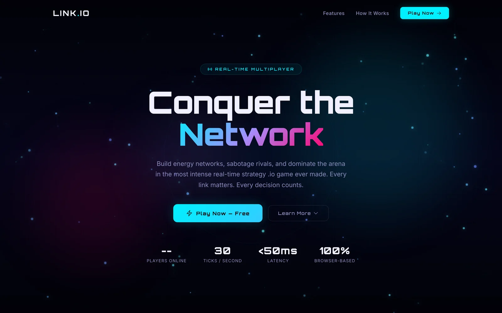

<div align="center">


# LINK.IO

**Conquer the network.**

A real-time multiplayer .io game in your browser.<br>
Link nodes into energy networks, cut your rivals' links and own the arena.

[](https://github.com/franciscogfsm/link-io/stargazers)
[](LICENSE)
[](https://github.com/franciscogfsm/link-io/commits)
[](https://github.com/franciscogfsm/link-io)
[](https://link-io-ten.vercel.app)

### [Play now, free](https://link-io-ten.vercel.app)

<sub>No download · No account · Runs in any modern browser</sub>

<br>



</div>

## How to play

| 1. Drop in | 2. Link | 3. Sabotage |
| --- | --- | --- |
| Pick a name and you're matched into a live room with other players. | Move through the anti-gravity arena and link the nodes you own into an energy network. | Break your rivals' links to cut their energy, defend your own, and grow the biggest network in the arena. |

## What's inside

- **Server-authoritative.** The game loop runs on the server at 30 ticks a second, with anti-cheat checks on every link.
- **Smooth on any connection.** The client interpolates between ticks, with particles and sound on a canvas renderer.
- **Rooms and matchmaking.** Socket.IO rooms, created and filled automatically.
- **One codebase, typed end to end.** Client and server share `shared/types.ts`.

## Run it

Needs Node 18 or newer.

```bash
npm run install:all
npm run dev
```

| | Address |
| --- | --- |
| Client | http://localhost:5173 |
| Server | http://localhost:3001 |
| Health check | http://localhost:3001/health |

## Layout

```
client/src/game/       renderer, camera, input, interpolation, particles, audio
client/src/screens/    landing, menu, game and game-over screens
client/src/network/    Socket.IO client
server/src/game/       authoritative game loop, rules and anti-cheat
server/src/rooms/      matchmaking and rooms
shared/types.ts        types shared by client and server
```

[`DEPLOY.md`](DEPLOY.md) covers production builds and hosting the client and server separately.

## Licence

[MIT](LICENSE) © Francisco Martins
